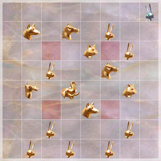
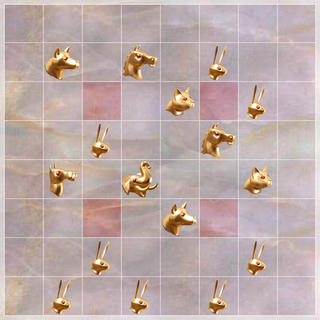
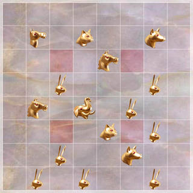
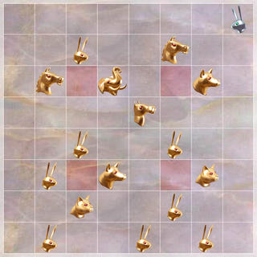

# arimaa-manymoves

Which [Arimaa](https://arimaa.com) position gives the side to move the most
different moves?

A turn in Arimaa is up to four steps, and pushes and pulls of enemy pieces
take two steps each. Different step sequences often end on the same board,
so the question counts **unique moves**: the distinct boards a turn can end
on, other than the board it started from. Repetition rules are ignored. Gold
is always the side to move here.

The best position found has **372,739** unique moves. With its one silver
piece removed it has **372,846**.

## Best positions

<table>
<tr>
<td align="center"><br>
<b>372,739</b>: legal position<br><code>boards/legal-372739.txt</code></td>
<td align="center"><br>
<b>372,846</b>: gold pieces only<br><code>boards/gold-372846.txt</code></td>
</tr>
<tr>
<td align="center"><br>
<b>371,500</b>: gold pieces only, the search's strongest attractor<br><code>boards/gold-371500.txt</code></td>
<td align="center"><br>
<b>359,661</b>: the previous record (aaaa, 2013)<br><code>boards/aaaa_top.txt</code></td>
</tr>
</table>

```
 +-----------------+
8| . . . . . . . r |    372,739 unique moves, gold to move
7| . D . H . R . . |
6| . . x . C x R . |    without the rabbit on h8: 372,846
5| . . R . . H . . |
4| . M . E . . C . |
3| . . x . D x . . |
2| . . R . . . R . |
1| . R . R . R . . |
 +-----------------+
   a b c d e f g h
```

There are two variants:

- **Legal**: a position that can arise in a game with gold to move. Both
  sides have a rabbit (otherwise the game is already over), no rabbit stands
  on its goal row, no trap holds an unguarded piece, and neither side has
  more pieces than an army.
- **Gold only**: gold pieces only, at most a full army.

### What the best positions look like

- **No two pieces are orthogonally adjacent**, so nearly every piece has all
  its neighbouring squares free. A piece next to another loses a step, and
  every step is worth thousands of moves, since it combines with whatever the
  other three steps do.
- **Files a and h and rank 8 are mostly empty.** Pieces on an edge have fewer
  squares to step to.
- **Most rabbits sit on ranks 1 and 2.** Rabbits can't step backward, so
  on rank 1 they lose nothing by it.
- **Which non-rabbit goes where barely matters.** Without enemy pieces to
  push, pull or be frozen by, strength is irrelevant. The pieces matter only
  as rabbits or not, and as identical pairs that can swap places. The search
  found the 371,500 squares several times, each time with the stronger pieces
  in a different order.
- **The silver rabbit is overhead.** The rules need one, and it goes on the
  square that costs least. h8 costs only 107 moves: no gold piece reaches it
  in fewer than 3 steps, and nothing stronger than a rabbit can get next to
  it in time to push or pull it. Every attempt to bring silver pieces within
  reach for pushes and pulls lost moves. A push or pull uses two steps and
  leaves two for the rest of the board (about 1,600 ways), while a single
  step leaves three (about 28,000 ways). On top of that, an adjacent silver
  piece blocks a square that gold pieces would otherwise step into.

## History

| Unique moves | Board | Notes |
|---|---|---|
| 339,806 | `boards/boardH11w.txt` | proposed by Fritzlein on the [arimaa.com forum](http://arimaa.com/arimaa/forum/cgi/YaBB.cgi?board=devTalk;action=display;num=1133599198;start=29#29) |
| 358,513 | `boards/boardH12w.txt` | Janzert's improvement on it |
| 359,661 | `boards/aaaa_top.txt` | aaaa's improvement on that (2013) |
| 370,473 | `boards/legal-370473.txt` | simulated annealing (this repository) |
| 372,739 | `boards/legal-372739.txt` | annealing on the 3-step count (this repository) |

## How it was done

### Counting

`count` explores every gold turn from a position. It does a depth-first
search over actions (single steps, pushes and pulls) with bitboards, resolving
captures after every step. Each board gets a 64-bit Zobrist hash.
Intermediate positions are deduplicated by hash and steps left, and the end
boards are collected in a hash set. A position with about 370,000 unique
moves takes 50 to 80 ms.

To make sure the count follows the rules exactly, it is checked against an
independent count. That one tries every legal step sequence with
[howdah](https://github.com/Janzert/howdah)'s `TurnBuilder`, which
applies the full rules (freezing, rabbit direction, pushes, pulls, traps)
step by step and compares whole boards rather than hashes:

- `count --ref` runs both on any board files.
- `crosscheck` runs both on random crowded positions, where pushes, pulls,
  freezing and captures are common. They agreed on 23,000 of them.
- The historical counts agree, and `aaaa_top` also matches pyrimaa's
  `get_moves()` from the [AEI](https://github.com/Janzert/AEI) reference
  implementation.

### Search

`search` uses **simulated annealing**. Its changes to a position are: move a
piece to a neighbouring square or anywhere, swap two different pieces, and add
or remove a piece. It enforces each variant's rules and the army limits.
Each run ends with a **polish**: hill climbing that tries every single change
(each piece to every empty square, every swap, every addition and removal)
until none helps.

Annealing on the full count is slow, at about 15 evaluations per second per
thread. The breakthrough came from **annealing on the 3-step count** (`search
--proxy 3`), the boards reachable in up to 3 steps. It takes about 1.6 ms,
about 50 times faster, and it tracks the full count closely: the best boards
by one are the best by the other. Each run keeps its 50 best boards by the
proxy, counts them exactly and polishes the best. One of the first eight
such runs found the 372,739 position.

Eight low-temperature runs started from the 372,846 gold-only board all
ended there, so it is a strong local maximum. That does not show it is the
global one.

### Lattices

The best boards are sparse and fairly regular, so `lattice` tried
structured candidates. It took every coset of every index-3, 4 and 5 integer
lattice with no two squares adjacent, and fitted each to 16 squares by
removing, adding or swapping up to two squares: about 1.8 million distinct
valid candidates.
It scored them with the 2-step and 3-step counts and polished the best. The
best result, 361,584, is well short of annealing, and the annealed board
beats every lattice candidate even on the 2-step count. The best positions
are not lattice fragments.

### Upper bound

No proof of optimality exists. `bound` computes a ceiling that no position
can exceed, explained in [BOUND.md](BOUND.md):

- Every end board can be described by the pieces that changed and where they
  ended up.
- A piece that ends `d` squares from its start used at least `d` of the four
  steps.
- Captures need extra care, done trap by trap.

That gives 588,575 for gold-only positions with nothing on the traps, and
more otherwise. The gap to 372,846 comes from what the bound ignores: pieces
blocking each other's squares, and two moves wanting the same square. A proof
would need a bound that captures both. An exhaustive search is out of reach:
there are about 3·10²² ways to place a gold army.

## Tools

Requires Rust (edition 2024). It depends on `howdah-arimaa` from
[howdah](https://github.com/Janzert/howdah) via git.

```bash
cargo build --release
target/release/count [--ref] BOARD...      # unique moves; --ref also counts with TurnBuilder
target/release/crosscheck [N] [SEED]       # fast count vs TurnBuilder on random crowded boards
target/release/search [--proxy 3] legal|gold [THREADS] [ITERS] [T_START] [T_END] [START_BOARD]
target/release/lattice [THREADS] [SWAPS]   # lattice-based candidates
target/release/bound [empty-traps] [SILVER...]   # upper bound over all positions
target/release/swaptest BOARD SQ...        # swap the rabbits on SQ... with stronger pieces
target/release/deltas legal|gold BOARD [N] # how much random search changes cost (for temperatures)
STEPS=3 target/release/bench N BOARD...    # time the counter (STEPS defaults to 4)
```

`search` writes new bests to `results/<variant>/<count>.txt` and each run's
local maximum to `results/<variant>/local-<count>.txt`. It runs until
stopped. The record came from
`search --proxy 3 legal 4 300000 2300 25` (temperatures are in units of the
3-step count; use about 30000 to 300 for the full count).

Board files use the long format's diagram (`8| . . r ... |`), with `x` or a
space for an empty square. Lines that aren't board rows are ignored.

The board pictures are drawn by `howdah-render` from
[howdah](https://github.com/Janzert/howdah), with the classic marble
artwork from the original arimaa.com client (public domain):

```bash
cargo run --release -p howdah-render -- --size 320 boards/legal-372739.txt images/legal-372739.jpg
```

## License

MIT. See [LICENSE](LICENSE).
